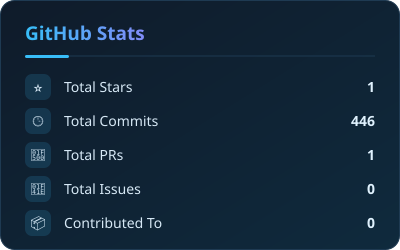
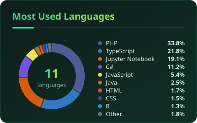
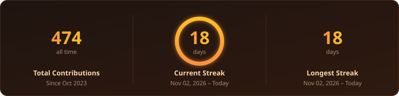
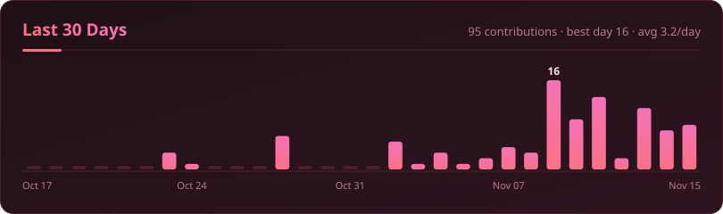
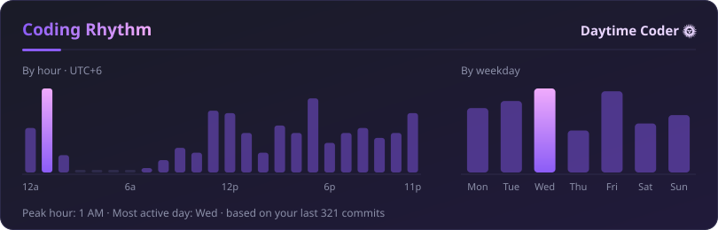
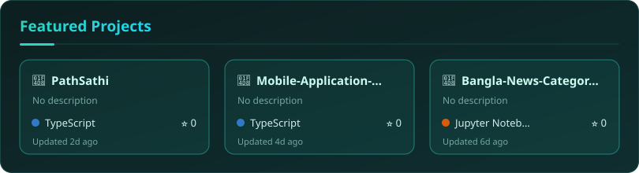
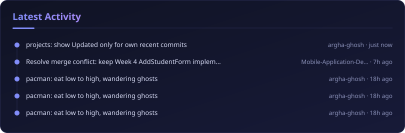
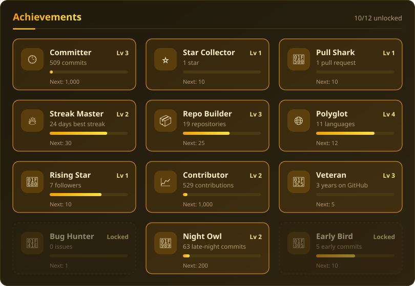

  
# 👋 Hello, I'm Argha Ghosh | Software Engineer

<h3>🌐 Connect Me With</h3>

&nbsp;&nbsp;&nbsp;
&nbsp;&nbsp;&nbsp;
&nbsp;&nbsp;&nbsp;
&nbsp;&nbsp;&nbsp;
&nbsp;&nbsp;&nbsp;

---

<table width="100%">
<tr>
<td width="55%" valign="top">

### 👨‍💻 About Me

- 👀 Interested in **Desktop-Based Applications => Ask me about this, feel free!**
- 🌱 Currently learning **Mobile App Development**
- 📱 Building Web Application & Desktop Application
- 🎮 Gamer by passion, developer by choice
- 📫 Reach me at **arghaghoshriddhi@gmail.com**

</td>
<td width="45%" align="center" valign="middle">

</td>
</tr>
</table>

 

---

### 🙋‍♂️ Who I Am

I'm a Computer Science student building real, working software — from full-stack web platforms and native desktop applications to cross-platform mobile apps. Most of my recent work centers on backend architecture, REST API design, and database-driven systems, paired with a genuine interest in clean code and maintainable structure over quick hacks.

**🎯 Open To**
- Internships and collaborative development projects
- Full-stack / frontend & backend both development opportunities
- Conversations about software development — feel free to ask!

---

### 🧠 Tech Stack

---

### 🧩 Core Competencies

| Domain | Details |
|---|---|
| **Full-Stack Web Development** | Building end-to-end apps with NestJS, PostgreSQL, TypeORM, and Next.js — auth flows, REST APIs, role-based modules |
| **Mobile Application Development** | Cross-platform apps with React Native + Expo, backed by __________ REST APIs and role-based flows |
| **Backend Architecture & APIs** | Designing modular REST API structures and JWT-based authentication for multi-developer codebases |
| **Database Design** | Relational schema design and query handling across PostgreSQL, SSMS and MySQL projects |
| **Desktop Application Development** | Exploring native desktop architecture with C# and .NET alongside desktop development |

---

### 🚀 Featured Projects

<b>📚 PathSathi — Tutor Matching Mobile App</b> 

 

A cross-platform mobile app (Education & Learning) that connects students and guardians with tutors. Students post tuition requests or browse tutors, tutors build profiles and apply, and students accept or reject applicants. Built as a 4-member group project for the Mobile Application Development course. Module owner for the Tutor side.

| Field | Detail |
|---|---|
| **Stack** | React Native · Expo · ___________ |
| **Role** | Module Owner (Tutor) |
| **Team** | PathSathi · 4 members |
| **Highlights** | 4 role-based user types, tutor verification flow, tuition board with apply/accept/reject |
| **Repository** | [View Repo](https://github.com/argha-ghosh/PathSathi) |

**📱 Mobile App Features**

| Role | Features |
|---|---|
| **Student / Guardian** | Find tutors, post tuition requests, review applicants, accept or reject |
| **Tutor** *(my module)* | Tutor profile, tuition board, apply to tuitions, My Applications tracking |
| **Moderator** | Verify tutors, review reports |
| **Admin** | Suspend users, manage moderators and categories |

<b>🏙️ ZonePortal — City Complaint Management System</b>

 

A full-stack civic complaint management platform built for a university course, handling complaint submission, a Corporation → Zone → Ward location hierarchy, tracking, and feedback. Module owner for ZoneOfficer, working alongside a team on Admin and Auth modules.

| Field | Detail |
|---|---|
| **Stack** | NestJS · PostgreSQL · TypeORM · Next.js |
| **Role** | Module Owner (ZoneOfficer) |
| **Highlights** | JWT auth (localStorage + cookies), ~35-route Postman API reference, merged dual codebases |
| **Repository** | [View Repo](https://github.com/argha-ghosh/Complain-Managment-System-Frontend-Backend-) |

<b>✈️ GoZayan — Flight Booking System</b>

 

A role-based flight ticket booking platform covering Admin, Manager, and Passenger workflows, with an airline-industry visual style and analytics dashboard.

| Field | Detail |
|---|---|
| **Stack** | PHP · MySQL · JavaScript · XAMPP |
| **Role** | Solo Developer |
| **Highlights** | IATA airport-code cards, notification system, Chart.js analytics dashboard |
| **Repository** | [View Repo](https://github.com/argha-ghosh/Online-flight-ticket-booking-system) |

<b>🍽️ Restaurant Management System</b>

 

A desktop based management system with Customer, Manager, and Admin roles, including integrated payment handling via bKash and card.

| Field | Detail |
|---|---|
| **Stack** | C#, .NET Framework Core, SSMSSQL  |
| **Role** | Developer |
| **Highlights** | Multi-role dashboards, payment gateway |
| **Repository** | [View Repo](https://github.com/argha-ghosh/BHOJ) |

<b>🌱 ZeroHunger</b>

 

A .NET Web API that coordinates restaurant food donations, rider collection, and distribution to people in need, with JWT-based role authorization.

| Field | Detail |
|---|---|
| **Stack** | C#, .NET 10, ASP.NET Core Web API, Entity Framework Core, 3Tier Application Setup for Multi Level Development, SQL Server, AutoMapper, JWT |
| **Role** | Developer |
| **Highlights** | 3-layer architecture (DAL/BLL/API), rider assignment with auto status updates, role-based access (Admin, Restaurant, Rider, Reviewer) |
| **Repository** | [View Repo](https://github.com/argha-ghosh/Zero-Hunger) |

---

### 📊 GitHub Statistics

---

**ᗧ· · · · 👻 This pacman is eating my contributions**

---

### 🔭 Current Focus

<table align="left" width="100%">
<tr>
<td width="50%" valign="top">

**📚 Learning**
- Advanced TypeScript patterns
- Clean architecture & SOLID principles

</td>
<td width="50%" valign="top">

**🛠️ Building**
- **PathSathi** — React Native + Expo + ASP.NET Core
- **Zero Hunger** — ASP .NET + SSMS-v24 + ASP .NET Core Web Application

</td>
</tr>
<tr>
<td width="50%" valign="top">

**🧠 Studying — NLP Course**
- Natural Language Processing fundamentals
- Text preprocessing, classification & language models
- Hands-on work with Python & Jupyter Notebook
- Course project: [NLP-Project](https://github.com/argha-ghosh/NLP-Project)

</td>
<td width="50%" valign="top">

**🧭 Exploring**
- Desktop application development (C# / .NET)

</td>
</tr>
<tr>
<td colspan="2" valign="top">

</td>
</tr>
</table>

---

<h4>💾 <b>Code. Add. Commit. Push. Repeat.</b></h4>

