# Argha Ghosh

**CS Student · Full-Stack · Mobile · Desktop Developer**

CS student at AIUB building real, working software — full-stack web platforms, cross-platform mobile apps, and native desktop applications. I focus on backend architecture, clean REST API design, and maintainable code over quick hacks.

---

## Quick Info

| | |
|:--|:--|
| 🔭 Currently building | **PathSathi** — tutor-matching mobile app (React Native + ASP.NET Core) |
| 🌱 Learning | Advanced TypeScript · Clean Architecture · SOLID principles |
| 🖥️ Passionate about | Desktop application development — feel free to ask |
| 🎯 Open to | Internships · collaborative projects · full-stack & backend roles |
| 📫 Contact | arghaghoshriddhi@gmail.com |

---

## Tech Stack

**Languages**

**Frontend & Mobile**

**Backend & Databases**

**Tools**

---

## Featured Projects

| Project | Description | Stack | My Role | Repo |
|:--|:--|:--|:--|:--:|
| � **PathSathi** `Latest` | Tutor-matching mobile app — students post tuition requests, tutors apply, students accept/reject. 4-member group project, 4 role-based user types. | React Native · Expo · ASP.NET Core | Module Owner (Tutor side) | [↗](https://github.com/argha-ghosh/PathSathi) |
| �️ **ZonePortal** | Civic complaint management platform with Corporation → Zone → Ward hierarchy. JWT auth, ~35-route API. | NestJS · PostgreSQL · TypeORM · Next.js | Module Owner (ZoneOfficer) | TODO |
| ✈️ **GoZayan** | Role-based flight booking system (Admin / Manager / Passenger) with analytics dashboard. | PHP · MySQL · JavaScript | Solo Developer | TODO |
| 🍽️ **Restaurant Management** | Multi-role restaurant system with bKash & card payment integration. | PHP · MySQL · JavaScript | Developer | TODO |
| ️ **Desktop Applications** | Standalone GUI apps exploring native desktop architecture and OOP design. | C# · .NET · Java | Developer | TODO |

---

## GitHub Stats

&nbsp;

  

---

## Pac-Man Contribution Graph

<picture>
  <source media="(prefers-color-scheme: dark)"  srcset="https://raw.githubusercontent.com/argha-ghosh/argha-ghosh/output/pacman-contribution-graph-dark.svg"/>
  <source media="(prefers-color-scheme: light)" srcset="https://raw.githubusercontent.com/argha-ghosh/argha-ghosh/output/pacman-contribution-graph.svg"/>
  
</picture>

---

## Connect

Code. Add. Commit. Push. Repeat.
